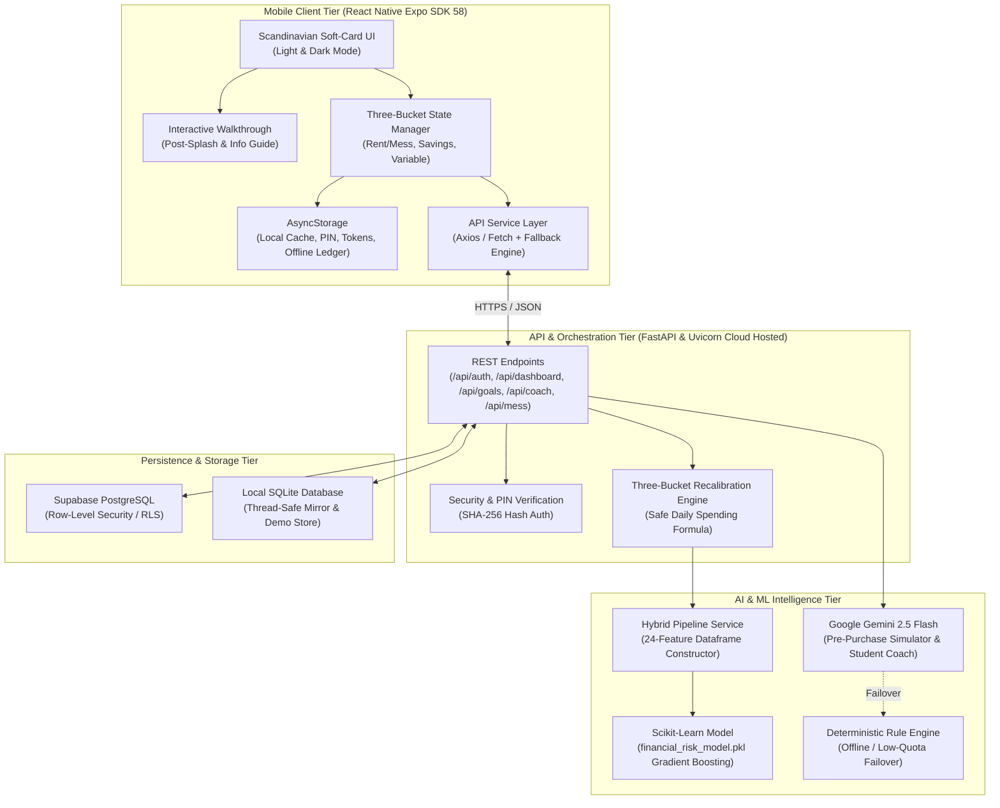

# Technical Requirements & System Architecture Document (TRD)
## Pockit — Student Money & Risk Coach
**Document Version:** `2.12.0`  
**Last Updated:** `2026-11-24`  
**Status:** Living Engineering Standard (Play Store Production Grade & Cloud Ready)

---

## 1. System Architecture Overview

Pockit is engineered as a privacy-conscious, client-server financial pacing and risk-warning platform optimized for university students in Bangladesh. The system combines an offline-resilient React Native mobile frontend (Expo SDK 58) with a high-throughput Python FastAPI backend hosting a hybrid machine learning risk scoring engine (`financial_risk_model.pkl`) and Google Gemini 2.5 Flash for contextual bilingual financial coaching.



---

## 2. Directory Structure & Codebase Topology

### 2.1 Mobile Application (`/mobile-app`)
The mobile client follows an atomic, single-responsibility modular structure:

```
mobile-app/
├── App.tsx                           # Master application lifecycle & state router
├── app.json                          # Expo configuration & Play Store manifest
├── eas.json                          # EAS build profiles (preview APK & production AAB)
├── assets/                           # High-resolution production visual assets
│   ├── adaptive-icon.png             # Android adaptive foreground (432x432)
│   ├── favicon.png                   # Web favicon
│   ├── icon.png                      # Play Store launcher icon (512x512)
│   ├── logo.jpg / logo.png           # Master brand mark
│   └── splash.png                    # Mobile boot splash (1284x2778)
├── package.json                      # Dependencies (React Native 0.81, Expo 58)
├── tsconfig.json                     # Strict TypeScript compiler options
└── src/
    ├── components/                   # Reusable UI & atomic design components
    │   ├── AmbientGlowBackground.tsx # Dual atmospheric corner glow
    │   ├── BrandLogo.tsx             # Scalable brand emblem with fallback
    │   ├── CompactRiskGauge.tsx      # Above-the-fold circular SVG risk ring
    │   ├── DisciplineTracker.tsx     # 7-day on-track discipline streak nodes
    │   ├── FeatureWalkthroughModal.tsx # Post-splash interactive guide
    │   ├── FormControls.tsx          # Minimalist inputs, toggles & select buttons
    │   ├── LeftoverSweepModal.tsx    # Month-end unspent variable money sweeper
    │   ├── LogExpenseModal.tsx       # Expense logger with quick presets
    │   ├── AddIncomeModal.tsx        # Multi-source income inflow logger
    │   ├── MessMealTrackerModal.tsx  # Mess assistant with mid-month editable total meals
    │   ├── PeerDebtModal.tsx         # Friend debt & borrowing tracker
    │   ├── SavingsGoalCard.tsx       # Dual-mode Dream Goal progress & boost card
    │   ├── UserAvatar.tsx            # Avatar with custom photo upload & Google sync
    │   └── WaveChart.tsx             # Spending trend visualization
    ├── constants/                    # Design tokens & localization
    │   ├── branding.ts               # Brand typography & color definitions
    │   ├── theme.ts                  # Scandinavian Soft-Card color palette
    │   ├── ThemeContext.tsx          # System Light/Dark mode state provider
    │   └── translations.ts           # Comprehensive English & Bengali copy
    ├── screens/                      # Primary view screens
    │   ├── SplashScreen.tsx          # Animated boot screen with pre-load
    │   ├── PinLockScreen.tsx         # 4-digit numeric security lock screen
    │   ├── AuthScreen.tsx            # Login, registration & 1-click instant demo
    │   ├── OnboardingWizard.tsx      # Baseline financial habits survey
    │   ├── HomeScreen.tsx            # 3-card minimalist dashboard
    │   ├── CalendarLedgerScreen.tsx  # Dynamic month calendar & transaction feed
    │   ├── GoalsScreen.tsx           # Dream Goal Vault management
    │   ├── AiCoachScreen.tsx         # Bilingual Gemini advisor & purchase simulator
    │   └── ProfileScreen.tsx         # Settings, theme, PIN, & feature tour
    └── services/                     # Device APIs & HTTP networking
        ├── api.ts                    # REST client & fallback demo data
        ├── notifications.ts          # Daily spending pacing push notifications
        ├── security.ts               # App lock PIN storage & verification
        └── supabaseClient.ts         # Supabase client with environment variable binding
```

### 2.2 Backend Service (`/backend`)
```
backend/
├── main.py                           # FastAPI application & REST endpoint routers
├── config.py                         # Environment variables, ports & file paths
├── database.py                       # Thread-safe SQLite / Supabase query layer
├── models.py                         # Pydantic v2 schemas for all requests/responses
├── pipeline_service.py               # Hybrid ML inference pipeline & feature mapper
├── train_model.py                    # Gradient Boosting training & evaluation script
├── gemini_advisor.py                 # Google Gemini 2.5 Flash integration & failover
├── feedback_store.py                 # User feedback & model prediction log store
├── requirements.txt                  # Python dependencies (FastAPI, scikit-learn, etc.)
├── Procfile                          # Cloud process runner (web: uvicorn main:app ...)
├── render.yaml                       # Render.com infrastructure blueprint
├── railway.json                      # Railway.app Nixpacks build config
└── models/
    └── financial_risk_model.pkl      # Serialized scikit-learn Gradient Boosting model
```

### 2.3 Google OAuth & Cloud Synchronization Pipeline
- **Deterministic Identity (`uuid.uuid5`):** All Google authentications convert the normalized student email into a deterministic UUID (`uuid.uuid5(uuid.NAMESPACE_DNS, email)`), guaranteeing cross-tier identity stability between local SQLite and Supabase PostgreSQL.
- **Universal Mobile Google OAuth Deep Linking & Lifecycle:**
  - Configured custom deep-link scheme `"scheme": ["pockit", "takatrack"]` in `app.json`.
  - **Dynamic Environment Routing:** In `AuthScreen.tsx`, detects `ExecutionEnvironment.StoreClient`. Inside **Expo Go**, uses `Linking.createURL('auth/callback')` (`exp://<LAN_IP>:8081/--/auth/callback`). In standalone APK builds, uses `makeRedirectUri({ scheme: 'pockit', path: 'auth/callback' })`.
  - **Automatic Browser Dismissal:** Calls `WebBrowser.dismissAuthSession()` immediately upon deep link interception or `onAuthStateChange` session detection to prevent Chrome Custom Tabs from freezing on screen after Google authorization.
  - **Supabase Whitelist Requirements (`URL Configuration`):**
    - **Site URL:** `https://pockit-backend.onrender.com` or `http://localhost:8081`
    - **Redirect URLs:** Must include wildcard entries:
      - `exp://**` (for physical mobile devices running Expo Go)
      - `pockit://**` (for standalone/production Android & iOS builds)
      - `http://localhost:8081/**` (for web development)
- **Offline Guest Mode Architecture:**
  - Managed under virtual identity `GUEST_USER_ID = 'guest_local_user'`.
  - All profile, expense, income, and savings goal transactions operate locally through `AsyncStorage` (`@takatrack_guest_*`).
  - Local mathematical engine (`calculateGuestDashboard`) computes the Three-Bucket allocations and dynamic daily safe spend limit entirely client-side without network dependencies.
- **Supabase Admin Identity Integration:** The backend utilizes the Supabase Service Role client (`supabase.auth.admin`) to create and update users directly in PostgreSQL `auth.users`, preserving relational foreign key integrity across child tables (`profiles`, `expenses`, `savings_goals`).

### 2.4 Student Financial Baseline & Budget Lifecycle Architecture
- **Continuous Custom Inputs & Quick Preset Pills (`CurrencyCustomInput`):**
  - Users input exact currency values using numeric keypads or fast 1-tap preset pills (`৳5k`, `৳8k`, `৳10k`, `৳15k`, `৳20k`).
  - The backend dynamically derives the 24-feature ordinal brackets (`<5k`, `5–10k`, `10–15k`, `15–20k`, `>20k`) for `financial_risk_model.pkl` Gradient Boosting inference.
- **Dedicated Budget Baseline Updater (`PUT /api/user/{user_id}/budget-baseline`):**
  - Allows students to adjust their total funds, fixed rent/mess, mess meal advance, semester tuition fees, and target savings anytime after onboarding.
  - Automatically re-evaluates the student's live ML risk score and recalibrates the Three-Bucket financial system.
- **Dual-Mode Dream Goal Vault Architecture:**
  - **Mode A (`monthly_amount`):** Float duration engine. $\text{Estimated Months Left} = \left\lceil \frac{\text{Target Amount} - \text{Current Saved}}{\text{Monthly Commitment}} \right\rceil$.
  - **Mode B (`target_timeline`):** Fixed target duration engine. $\text{Required Monthly Savings} = \left\lceil \frac{\text{Target Amount} - \text{Current Saved}}{\text{Remaining Months}} \right\rceil$. Automatically updates `profiles.target_savings` and synchronizes into the Safe Daily Spending Limit formula.
  - **Dynamic Boost Recalculation:** In Mode B, adding funds reduces required monthly savings while keeping the target date invariant.
- **Mid-Month Mess Meal Assistant (`PUT /api/mess/total-meals`):**
  - Enables students who onboard midway through the calendar month (e.g. Day 15) to input prior cumulative meals consumed so far.
  - Real-time formula calculates `consumed_food_cost = total_meals * estimated_meal_rate` and `advance_surplus = meal_advance_paid - consumed_food_cost`.
  - Automatically manages accommodation defaults: Mess/Hostel living defaults `enable_mess_meals = True`, while Rented Flat defaults `enable_mess_meals = False`.
- **Web App Cashflow Ledger Deletion & Optimistic UI Pipeline:**
  - Replaced browser `window.confirm` with in-app Scandinavian soft-card modal dialog to bypass Chromium mobile emulation dialog suppression.
  - Performs optimistic UI transaction removal from state with immediate live recalculation of daily inflow, outflow, and net balance.

### 2.5 Calibrated Hybrid Risk Model & Watertight Partial Obligation Engine
- **Late-Month Pacing Dominance Algorithm (`backend/pipeline_service.py`):**
  - Implements adaptive dynamic weighting schedule based on month day progress ($d / D$):
    - $d / D < 0.23$ (Days 1–7): $0.50 \times \text{Base ML} + 0.50 \times \text{Live Pacing}$
    - $0.23 \le d / D < 0.67$ (Days 8–20): $0.30 \times \text{Base ML} + 0.70 \times \text{Live Pacing}$
    - $d / D \ge 0.67$ (Days 21–31): $0.10 \times \text{Base ML} + 0.90 \times \text{Live Pacing}$
  - **Dynamic Safety Clamps:**
    - If $\text{daily\_safe} \ge 250 \text{ Tk/day}$ and savings are intact: Risk is capped at $\le 30.0\%$ (Low Risk).
    - If $\text{daily\_safe} \ge 180 \text{ Tk/day}$ and savings are intact: Risk is capped at $\le 42.0\%$.
    - If $\text{daily\_safe} \ge 120 \text{ Tk/day}$ and savings are intact: Risk is capped at $\le 58.0\%$.
- **Watertight Partial Obligation Ring-Fencing:**
  - Prevents accidental release of unpaid rent/mess into daily pocket funds:
    $$\text{unpaid\_fixed} = \max(0.0, \text{fixed\_baseline\_total} - \text{fixed\_obligations\_spent})$$
    $$\text{total\_fixed\_reserved} = \text{fixed\_obligations\_spent} + \text{unpaid\_fixed} = \max(\text{fixed\_baseline\_total}, \text{fixed\_obligations\_spent})$$
    $$\text{spendable\_variable\_pool} = \text{monthly\_allowance} - \text{total\_fixed\_reserved} - \text{target\_savings} - \text{variable\_spent}$$

---

## 3. Financial Engine & Three-Bucket Mathematical Model

### 3.1 The Three-Bucket Formula
Traditional budgeting fails students because essential fixed commitments (mess food advances and hall rent) get conflated with discretionary daily pocket money. Pockit enforces a strict Three-Bucket model:

$$\text{Total Inflow} = \text{Monthly Allowance Baseline} + \sum \text{Incomes Added This Month}$$

$$\text{Fixed Obligations} = \max(\text{Fixed Rent Baseline}, \text{Rent Paid} + \text{Mess Advance Paid})$$

$$\text{Spendable Variable Pool} = \text{Total Inflow} - \text{Fixed Obligations} - \text{Target Savings} - \text{Variable Spent}$$

$$\text{Safe Daily Spending Limit} = \max\left(0.0, \frac{\text{Spendable Variable Pool}}{\text{Days Remaining in Month}}\right)$$

### 3.2 Savings Overdraft Detection
If $\text{Spendable Variable Pool} \le 0$:
- The daily safe spending limit collapses to `৳0.0 / day`.
- The system checks whether $\text{Total Inflow} - \text{Fixed Obligations} - \text{Variable Spent} < \text{Target Savings}$.
- If true, the user is flagged in **Savings Overdraft** (`dipping_into_savings = True`), generating an instant alert:
  > *"Daily budget exhausted — further spending will dip into your ৳X Savings Goal!"*

### 3.3 Dynamic Month-End Burn Rate Projection
$$\text{Day Progress} = \max\left(0.1, \min\left(1.0, \frac{\text{Current Day}}{\text{Total Days in Month}}\right)\right)$$

$$\text{Projected Month-End Spend} = \frac{\text{Total Spent}}{\text{Day Progress}}$$

$$\text{Projected Savings} = \max(0.0, \text{Total Inflow} - \text{Projected Month-End Spend})$$

---

## 4. Machine Learning Inference Pipeline (`financial_risk_model.pkl`)

### 4.1 Feature Space (24-Column Schema)
The machine learning model is a Gradient Boosting Classifier trained on real Bangladeshi university student survey data. In inference, live real-time transactions are dynamically mapped into the model's exact 24-feature space:

| # | Feature Name in Model | Data Type | Live Source / Dynamic Transformation |
|---|----------------------|-----------|--------------------------------------|
| 1 | `Gender` | String | User profile (`Male` / `Female`) |
| 2 | `Age (Years)` | Integer | User profile (e.g., `21`) |
| 3 | `Year of study` | Ordinal | Mapped to `[1st year, 2nd year, 3rd year, 4th year, Masters]` |
| 4 | `University type` | String | `Public`, `Private`, `National`, `Engineering/Medical` |
| 5 | `Where you live` | String | `Mess-hostel`, `With family`, `Rented flat` |
| 6 | `Total monthly money available (Tk)` | Ordinal | Dynamically updated from current month's total inflow (`<5k`, `5–10k`, `10–15k`, `15–20k`, `>20k`) |
| 7 | `Main source of money` | String | `Family`, `Tuition`, `Self-earned`, `Scholarship` |
| 8 | `Do you earn your own income?` | String | `Yes` / `No` |
| 9 | `Monthly rent/accommodation (Tk)` | Ordinal | Dynamically computed from fixed rent + mess paid (`0`, `<3k`, `3–6k`, `6–9k`, `>9k`) |
| 10 | `Monthly food (Tk)` | Ordinal | Projected from actual food expenses over elapsed days (`<3k`, `3–5k`, `5–7k`, `>7k`) |
| 11 | `Monthly transport (Tk)` | Ordinal | Projected from actual transport expenses (`<1k`, `1–2k`, `2–3k`, `>3k`) |
| 12 | `Monthly online shopping / entertainment (Tk)` | Ordinal | Projected from entertainment + lifestyle spending (`<1k`, `1–2k`, `>2k`) |
| 13 | `I track my spending` | Integer (1-5) | Baseline Likert score from onboarding survey |
| 14 | `Money saved per month (Tk)` | Ordinal | **Dynamic**: Evaluated from effective protected savings + projected month-end surplus (`0`, `<500`, `500–1k`, `>1k`) |
| 15 | `Mobile banking use (bKash/Nagad/Rocket)` | Ordinal | Dynamically computed from transaction count (`Daily` if >14 tx, `Weekly` if ≥4 tx, else `Rarely`) |
| 16 | `Borrowed money from friends in last 3 months` | Ordinal | Dynamically computed from `Borrowing` expense logs (`Never`, `1–2`, `3+`) |
| 17 | `aware_balance` | Integer (1-5) | Likert survey: "I know my account balance at all times" |
| 18 | `aware_weekly_track` | Integer (1-5) | Likert survey: "I check my spending weekly" |
| 19 | `aware_check_before_buy` | Integer (1-5) | Likert survey: "I check funds before making purchases" |
| 20 | `impulse_spontaneous` | Integer (1-5) | Likert survey: "I buy things spontaneously without planning" |
| 21 | `impulse_discounts` | Integer (1-5) | Likert survey: "Discounts and flash sales trigger me to buy" |
| 22 | `impulse_regret` | Integer (1-5) | Likert survey: "I often feel regret after spending money" |
| 23 | `awareness_score` | Float | Calculated: $\text{mean}(\text{aware\_balance}, \text{aware\_weekly}, \text{aware\_check})$ |
| 24 | `impulse_score` | Float | Calculated: $\text{mean}(\text{impulse\_spontaneous}, \text{impulse\_discounts}, \text{impulse\_regret})$ |

### 4.2 Risk Tiers & Probability Thresholds
The output probability $P(\text{Shortage})$ is scaled to $0.0\% - 100.0\%$:
- **LOW RISK ($0.0\% - 39.9\%$):** Controlled burn rate, projected month-end surplus intact.
- **MODERATE RISK ($40.0\% - 69.9\%$):** Elevated variable burn or shrinking buffer; cautionary spending limits recommended.
- **HIGH RISK ($70.0\% - 100.0\%$):** Critical burn trajectory; high likelihood of running out of money before month-end.

---

## 5. Bilingual Gemini 2.5 Flash Integration & Graceful Failover

### 5.1 AI Capabilities
- **Pre-Purchase Simulator ("Ask AI Before I Buy"):** Simulates the exact impact of an item on the student's safe daily spending limit and financial risk probability *before* purchase.
- **Smart Financial Coach:** Generates contextual tips tailored to Bangladeshi campus life (e.g., mess vs. eating out, Rickshaw vs. walking short distances, sharing tuition notes).

### 5.2 Deterministic Offline / Quota Fallback
If the Google Gemini API key is missing, network is offline, or rate limits are reached, the system automatically falls back to an internal deterministic expert-rule engine that generates actionable, human-like bilingual coaching without throwing an error:
```python
# Fallback logic in backend/gemini_advisor.py
if not GEMINI_API_KEY or gemini_client is None:
    return generate_deterministic_advice(budget_data, language)
```

---

## 6. Client State Management & Offline Resiliency

1. **Local State Cache:** User credentials, PIN hashes, language preference, theme preference, and walkthrough completion flags are stored locally in `@react-native-async-storage/async-storage`.
2. **Cold-Start & Offline Resilience:** When the cloud backend is cold-starting (Render free tier) or when network connectivity drops, `fetchWithTimeout` aborts after 8s and seamlessly switches to local state and mathematical calculations (`calculateGuestDashboard`), preventing client freezes.
3. **Demo Mode:** When offline or exploring without an account, `FALLBACK_DEMO_DASHBOARD` provides a realistic, fully interactive snapshot of a student at Dhaka University with live calculations.
4. **Optimistic Updates:** Adding an income, expense, or savings boost updates local state immediately before re-fetching live server aggregates.

---

## 7. Cloud Backend Deployment & Android EAS Compilation Architecture

### 7.1 FastAPI Backend Deployment Architecture (Render / Railway)
- **Dynamic Port Binding:** The application binds to the dynamic `$PORT` environment variable provided by cloud hosts via `uvicorn main:app --host 0.0.0.0 --port $PORT`.
- **Infrastructure Blueprint (`render.yaml`):**
  ```yaml
  services:
    - type: web
      name: pockit-backend
      runtime: python
      plan: free
      region: oregon
      buildCommand: pip install --upgrade pip && pip install -r requirements.txt
      startCommand: uvicorn main:app --host 0.0.0.0 --port $PORT
      healthCheckPath: /
  ```
- **Nixpacks Configuration (`railway.json`):**
  Configured with Python 3.11 builder, caching pip dependencies across commits.
- **CORS Middleware Security:**
  `CORSMiddleware` configured with `allow_origins=["*"]`, `allow_methods=["*"]`, `allow_headers=["*"]`, enabling native Android APKs, Expo web preview, and local developer clients to communicate with the cloud REST API.

### 7.2 Expo Application & EAS APK Compilation Architecture
- **Application Manifest (`mobile-app/app.json`):**
  - **Android Package Identifier:** `com.pockit.app`
  - **Version & Build Code:** `version: "1.0.0"`, `versionCode: 1`
  - **Permissions:** `INTERNET`, `ACCESS_NETWORK_STATE`
  - **Deep Link Intent Filters:** Configured for `pockit://auth` and `takatrack://auth` for Supabase OAuth redirects.
- **EAS Build Profiles (`mobile-app/eas.json`):**
  - **`preview` Profile (Standalone APK):**
    ```json
    "preview": {
      "distribution": "internal",
      "android": {
        "buildType": "apk"
      },
      "env": {
        "EXPO_PUBLIC_API_URL": "https://pockit-backend.onrender.com",
        "EXPO_PUBLIC_SUPABASE_URL": "https://pockit-auth.supabase.co"
      }
    }
    ```
    Builds a direct installable `.apk` file that can be installed on any physical Android phone via USB or direct download link.
  - **`production` Profile (Google Play Store AAB):**
    ```json
    "production": {
      "android": {
        "buildType": "app-bundle"
      }
    }
    ```
    Builds an optimized `.aab` (Android App Bundle) ready for upload to Google Play Console.
- **EAS Build Commands:**
  ```bash
  # Standalone installable APK for physical device testing
  eas build --platform android --profile preview

  # Google Play Store release bundle (.aab)
  eas build --platform android --profile production
  ```
